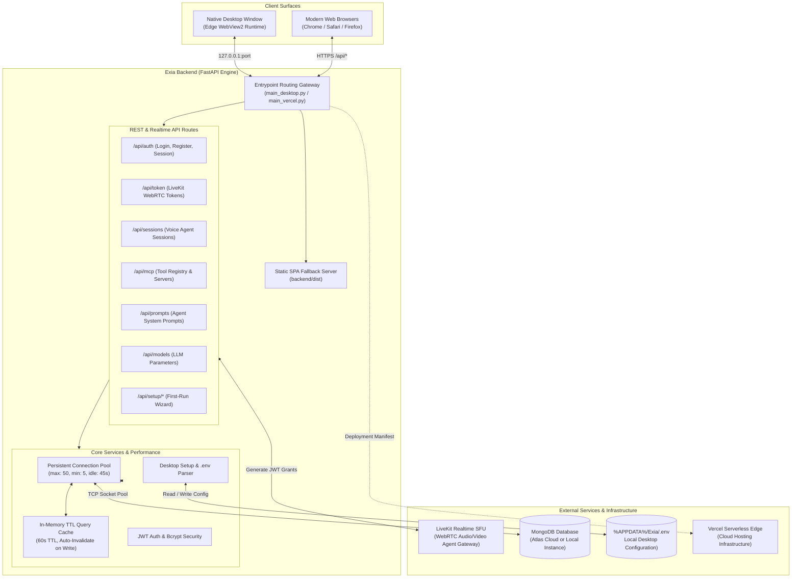
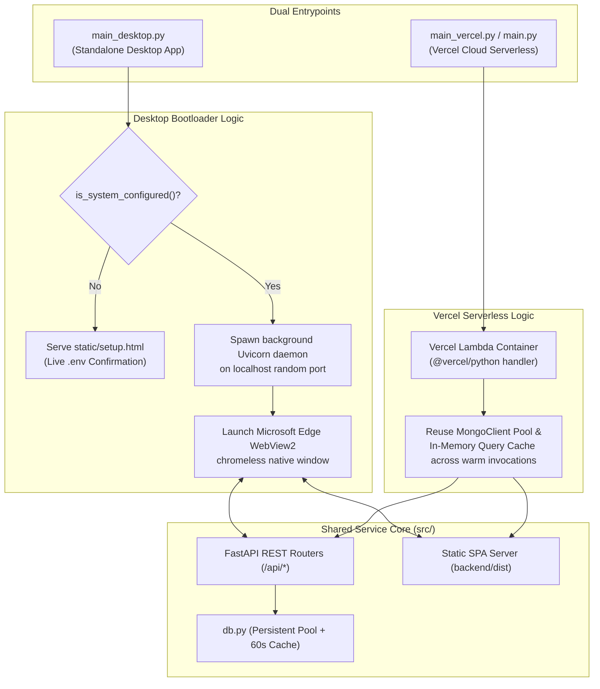
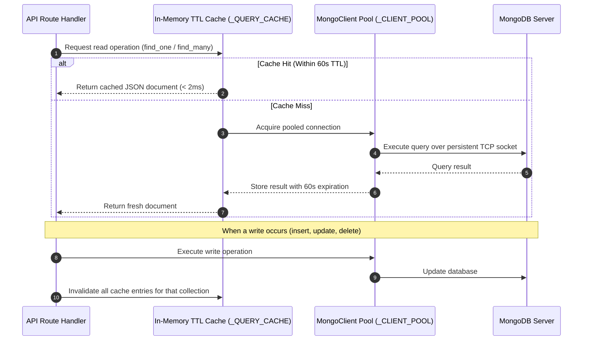

# Exia — Backend Service Architecture & Reference

Welcome to the backend service for **Exia**, the AI-powered Home Assistant and Voice Agent platform. This directory contains the complete Python backend engine designed to execute seamlessly in two distinct environments:
1. **As a Native Windows Desktop Application (`Exia.exe`)** via Edge WebView2.
2. **As a Serverless Cloud Application on Vercel** via `@vercel/python`.

---

## 1. Overall System Architecture & External Integrations

The backend acts as the central orchestrator connecting the frontend user interface, voice agent WebRTC streams, persistent databases, and local operating system resources:



---

## 2. Directory & File Inventory

Below is an exhaustive breakdown of every file in the `backend/` directory and its exact responsibility:

```
backend/
├── main.py                     # Default Vercel bridge entrypoint (re-exports app)
├── main_desktop.py             # Desktop app lifecycle (Uvicorn daemon + WebView2 window)
├── main_vercel.py              # Pure Vercel serverless ASGI application
├── desktop_bootstrap.py        # Setup verification, live DB ping test, operator seeding
├── exia.spec                   # PyInstaller single-file build specification
├── exia-icon.ico               # Desktop application window and taskbar icon
├── vercel.json                 # Vercel serverless routing and builder definition
├── requirements.txt            # Auto-synced Vercel runtime dependencies
├── requirements-desktop.txt    # Desktop dependencies (+ pywebview & pyinstaller)
├── requirements-vercel.txt     # Clean serverless dependencies for Vercel
├── pyproject.toml / uv.lock    # Project dependencies & lockfile
├── .env / .env.example         # Environment variable configuration templates
│
├── static/                     # Embedded resources bundled into desktop executable
│   └── setup.html              # Dark-mode First-Run Setup Wizard with .env paste mode
│
├── dist/                       # Production build of frontend Next.js/React SPA
│   ├── index.html              # Main HTML entrypoint
│   ├── _next/                  # Bundled JavaScript, CSS, and asset chunks
│   └── favicon.ico             # Web favicon
│
└── src/                        # Shared business logic, schemas, and routes
    ├── constants/
    │   ├── config.py           # Multi-path .env resolver (%APPDATA%, local, bundle)
    │   ├── models.py           # Pydantic data models (User, Session, Prompt, MCP)
    │   └── shema.py            # MongoDB collection names and database constants
    │
    ├── routes/
    │   ├── auth.py             # User authentication, registration, JWT validation
    │   ├── token.py            # LiveKit access token generation for voice agent
    │   ├── sessions.py         # Voice session history, recording metadata, CRUD
    │   ├── mcp.py              # Model Context Protocol server registrations
    │   ├── prompts.py          # Custom prompt templates & system instructions
    │   └── model_config.py     # LLM provider configs (Gemini, OpenAI, Anthropic)
    │
    ├── services/
    │   ├── db.py               # Persistent MongoClient pooling + In-Memory TTL Cache
    │   ├── auth.py             # Authentication business logic & token blacklist
    │   ├── security.py         # Bcrypt password hashing and cryptographic tokens
    │   ├── sessions.py         # Session querying and mutation handlers
    │   ├── mcp.py              # MCP server database interactions
    │   ├── prompts.py          # Prompt template database interactions
    │   ├── model_config.py     # AI model configuration persistence
    │   └── token_blacklist.py  # Revoked JWT tracking
    │
    └── utils/
        └── auth.py             # FastAPI dependency injection for current_user
```

---

## 3. Dual-Entrypoint Routing Flow

The codebase maintains a strict separation of concerns between desktop execution and cloud serverless hosting while sharing 100% of routes and database services:



---

## 4. Database Optimization: Pooling & In-Memory TTL Query Caching

To prevent connection exhaustion and eliminate query latency (previously 150–400ms per call due to per-request client disconnection), [`backend/src/services/db.py`](file:///e:/potfolio/Exia/backend/src/services/db.py) employs a **two-tier acceleration model**:



---

## 5. One-Time Desktop Environment Setup

When launching Exia Desktop for the first time without pre-existing configuration, Exia displays the embedded Setup Wizard (`static/setup.html`). The user configures their own environment **one time**:

1. **MongoDB Database & Custom Collections**:
   - Connection URI with live `Test Connection` verification.
   - Database name (e.g. `exia_db`).
   - Custom collection names (User can name collections: `users`, `sessions`, `mcp_servers`, `prompts`, `model_config`, `token_blacklist`).
2. **Authentication & Custom JWT Tokens**:
   - Custom JWT secret input or one-click `🎲 Generate Key` button (32-byte cryptographically secure random token).
   - JWT Algorithm selection (`HS256`, `HS384`, `HS512`).
3. **Operator Account Enrollment**:
   - Operator display name, email, and password.
   - Hashes password using `bcrypt` and inserts operator record into the user's custom collection.
4. **LiveKit Realtime Gateway**:
   - Host URL, API Key, and Secret.
5. **Persistence**:
   - Writes all verified parameters to `%APPDATA%\Exia\.env`.
   - On all future launches, Exia detects the configuration and starts immediately without prompting again.

---

## 6. Development & Deployment Commands

The backend is built and deployed using the scripts in the root [`scripts/`](file:///e:/potfolio/Exia/scripts) folder:

### A. Run Desktop Application Locally (Development Mode)
```bash
# Starts local backend with native Edge WebView2 window
python backend/main_desktop.py
```

### B. Build Windows Desktop Executable (`Exia.exe`)
```bash
# Automated single-command build via PyInstaller
./scripts/desktop.sh
```
*Outputs: `release/Exia.exe` (Standalone native executable with embedded icon and frontend bundle).*

### C. Deploy to Vercel via Vercel CLI
```bash
# Deploy preview build
./scripts/vercel.sh

# Deploy directly to production
./scripts/vercel.sh --prod
```
