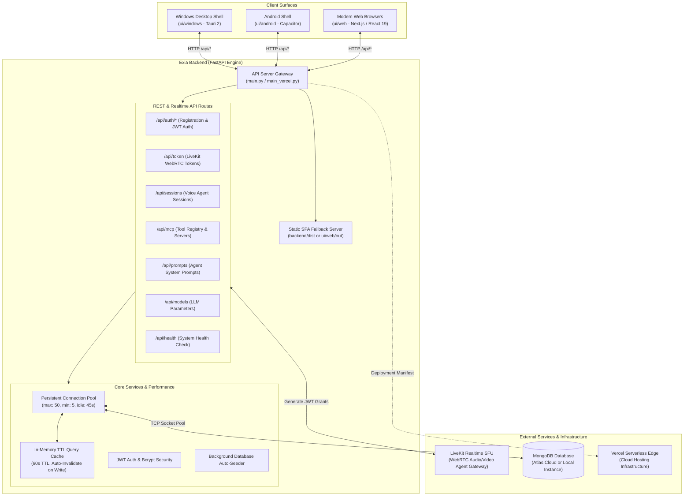
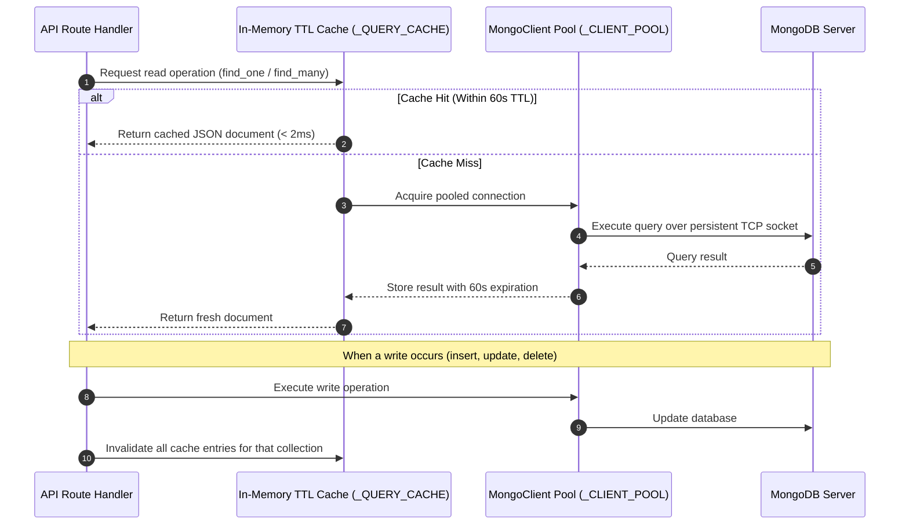

# Exia — Backend Service Architecture & Reference

Welcome to the backend service for **Exia**, the AI-powered Home Assistant and Voice Agent platform. This directory contains the complete Python backend engine designed to execute as:
1. **The Core FastAPI Server Gateway (`main.py`)** serving all UI clients (Next.js Web, Capacitor Android, and Tauri Windows).
2. **A Serverless Cloud Application on Vercel (`main_vercel.py`)** via `@vercel/python`.

---

## 1. Overall System Architecture & External Integrations

The backend acts as the central orchestrator connecting the frontend client surfaces, voice agent WebRTC streams, persistent databases, and external AI providers:



---

## 2. Directory & File Inventory

Below is the directory structure of `backend/`:

```
backend/
├── main.py                     # Main FastAPI Server Gateway (local development & production)
├── main_vercel.py              # Pure Vercel serverless ASGI application
├── vercel.json                 # Vercel serverless routing and builder definition
├── requirements.txt            # Auto-synced runtime dependencies
├── requirements-vercel.txt     # Clean serverless dependencies for Vercel
├── pyproject.toml / uv.lock    # Project dependencies & lockfile (managed with uv)
├── .env / .env.example         # Environment variable configuration templates
│
├── dist/                       # Static production build export of frontend SPA
│   ├── index.html              # Main HTML entrypoint
│   ├── _next/                  # Bundled JavaScript, CSS, and asset chunks
│   └── favicon.ico             # Web favicon
│
└── src/                        # Shared business logic, schemas, and routes
    ├── constants/
    │   ├── config.py           # Multi-path .env resolver & Pydantic application settings
    │   ├── models.py           # Pydantic data models (User, Session, Prompt, MCP)
    │   └── shema.py            # MongoDB collection names and database constants
    │
    ├── routes/
    │   ├── auth.py             # User account creation, registration, JWT login, token refresh
    │   ├── token.py            # LiveKit access token generation for voice agent
    │   ├── sessions.py         # Voice session history, recording metadata, CRUD
    │   ├── mcp.py              # Model Context Protocol server registrations
    │   ├── prompts.py          # Custom prompt templates & system instructions
    │   └── model_config.py     # LLM provider configs (Gemini, OpenAI, Anthropic)
    │
    ├── services/
    │   ├── db.py               # Persistent MongoClient pooling + In-Memory TTL Cache
    │   ├── auth.py             # Authentication business logic & token blacklist
    │   ├── security.py         # Bcrypt password hashing and cryptographic tokens
    │   ├── sessions.py         # Session querying and mutation handlers
    │   ├── mcp.py              # MCP server database interactions
    │   ├── prompts.py          # Prompt template database interactions
    │   ├── model_config.py     # AI model configuration persistence
    │   ├── bootstrap_seed.py   # Initial database seeder for fresh environments
    │   └── token_blacklist.py  # Revoked JWT tracking
    │
    └── utils/
        └── auth.py             # FastAPI dependency injection for current_user
```

---

## 3. Database Optimization: Pooling & In-Memory TTL Query Caching

To prevent connection exhaustion and eliminate query latency, [`backend/src/services/db.py`](file:///e:/potfolio/Exia/backend/src/services/db.py) employs a **two-tier acceleration model**:



---

## 4. Development & Deployment Commands

### A. Run Backend API Locally (Development Mode)
```bash
# Start backend server with uvicorn
cd backend
uv run uvicorn main:app --reload --host 0.0.0.0 --port 8000
# Or directly with python
uv run python main.py
```

### B. Run the Backend with Docker

From the `backend/` directory, build the image and pass your local `.env` file
to the container at runtime:

```bash
docker build -t exia-backend .
docker run --rm --name exia-backend -p 8000:8000 --env-file .env exia-backend
```

The image installs the locked production dependencies from `pyproject.toml`
and `uv.lock` using uv. The `.env` file is not copied into the image. Create it
from `.env.example` and fill in the required values before running the container.

### C. Deploy to Vercel via Vercel CLI
```bash
# Deploy preview build
./scripts/vercel.sh

# Deploy directly to production
./scripts/vercel.sh --prod
```
