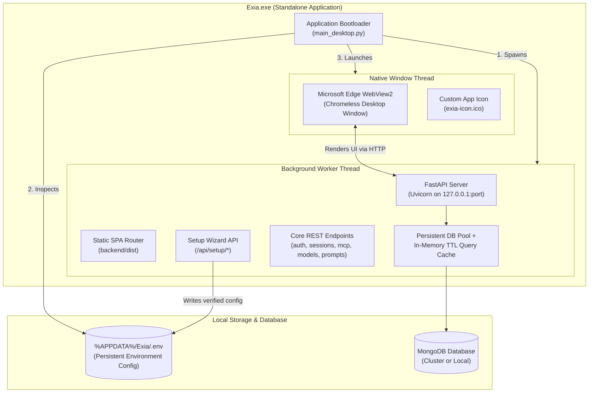
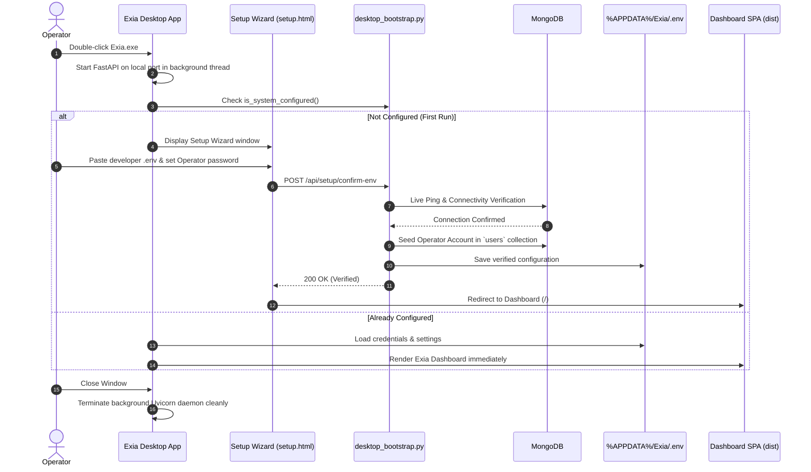

# Exia Desktop Application — Architecture & Workflow

This document explains the architecture, execution lifecycle, first-run configuration flow, and packaging pipeline of the **Exia Windows Desktop Application (`Exia.exe`)**.

---

## 1. System Overview

Exia Desktop runs as a **native Windows desktop application** (similar to VS Code or Discord) rather than running in an external web browser. It bundles an embedded FastAPI server, persistent database connection pool, in-memory TTL query cache, and the pre-built React/Next.js frontend into a single standalone executable.



---

## 2. Desktop Execution Lifecycle

When the user double-clicks `Exia.exe`, the application executes the following sequential lifecycle:



---

## 3. First-Run Setup: One-Time User-Configured Credentials

During the initial launch of the desktop application, the user configures their own environment credentials **once**. They can name custom database collections, configure or generate JWT security keys, and enroll their operator account:

1. **MongoDB Database & Custom Collection Names**:
   - MongoDB connection URI with live in-app connection testing.
   - Database name (default `exia_db`).
   - Customizable collection names:
     - `users` (Operator & account storage)
     - `sessions` (Voice agent conversation histories)
     - `mcp_servers` (MCP tool integrations)
     - `prompts` (System prompt templates)
     - `model_config` (LLM parameters)
     - `token_blacklist` (Revoked JWT tokens)
2. **Authentication & Custom JWT Tokens**:
   - Custom JWT secret input or one-click `🎲 Generate Key` (generates a 64-character hex key).
   - JWT Algorithm selection (default `HS256`).
3. **Operator Account Enrollment**:
   - Operator display name, email, and password.
   - Password is salted and hashed with `bcrypt`, then seeded into the user's custom collection.
4. **LiveKit Realtime Gateway (Optional)**:
   - LiveKit Host URL, API Key, and Secret.
5. **Persistence in `%APPDATA%/Exia/.env`**:
   - Configuration is written permanently to `%APPDATA%\Exia\.env`.
   - On future app launches, `is_system_configured()` returns `True`, bypassing the setup wizard and opening the dashboard directly.

---

## 4. In-Memory Caching & Database Performance

In the desktop environment, every query previously incurred connection handshake latency. The desktop backend incorporates high-performance database caching:

* **Persistent Connection Pool**: Reuses an active `MongoClient` pool (`maxPoolSize=50`, `minPoolSize=5`, `maxIdleTimeMS=45000`) across all requests.
* **60-Second TTL Query Cache**: Caches responses from `find_one`, `find_many`, `count_documents`, and `exists`.
* **Automatic Invalidation**: When any modification occurs (`insert_one`, `update_one`, `delete_many`), the cache for that collection is instantly purged.
* **Result**: Query times for repeated reads drop from ~250ms to **under 2ms**.

---

## 5. Build & Packaging Pipeline (`scripts/desktop.sh`)

The desktop application is built using the unified shell script:

```bash
./scripts/desktop.sh
```

### Build Steps:
1. **Prerequisite Check**: Automatically detects Python and installs desktop dependencies from [`backend/requirements-desktop.txt`](file:///e:/potfolio/Exia/backend/requirements-desktop.txt) (`pyinstaller`, `pywebview`, etc.) via `pip`.
2. **Asset Synchronization**: Verifies that the production frontend SPA is present in `backend/dist` (building with `pnpm/npm` if needed).
3. **PyInstaller Compilation**: Executes PyInstaller using [`backend/exia.spec`](file:///e:/potfolio/Exia/backend/exia.spec):
   - Packages `main_desktop.py` with `console=False` (no terminal black box).
   - Bundles `dist` and `static/setup.html`.
   - Embeds the desktop application icon (`exia-icon.ico`).
   - Uses Microsoft Edge WebView2 runtime installed natively on Windows 10/11.
4. **Output**: Produces the standalone executable at `release/Exia.exe`.
