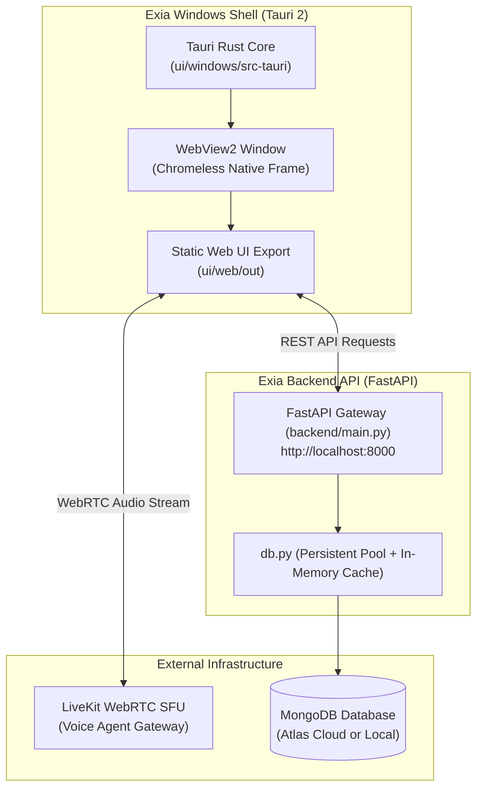

# Exia Desktop Application — Architecture & Workflow

This document explains the architecture, execution lifecycle, and build workflow of the **Exia Windows Desktop Application**, built with **Tauri 2** in [`ui/windows`](file:///e:/potfolio/Exia/ui/windows).

---

## 1. System Overview

Exia Desktop runs as a **native Windows desktop application** built with Tauri 2 and Rust, rendering the static export of the Next.js frontend (`ui/web`) via Microsoft Edge WebView2, and connecting to the Exia FastAPI backend server.



---

## 2. Desktop Workflow & Build Pipeline

The desktop client can be packaged using the automated root build script or manual workflow:

### Automated Script (Recommended)
```bash
# Production release build (mirrored to release/Exia-Setup.exe)
./scripts/desktop.sh

# Fast debug compilation
./scripts/desktop.sh --debug

# Build Tauri shell using existing web export without rebuilding Next.js
./scripts/desktop.sh --skip-web

# Clean target caches before compiling
./scripts/desktop.sh --clean
```

### Manual Workflow
```bash
# 1. Build the shared frontend static export
cd ui/web
npm run build

# 2. Build the native Windows desktop bundle (NSIS installer & portable exe)
cd ui/windows
npm run build
```

* Output: Standalone installer generated in `ui/windows/src-tauri/target/release/bundle/nsis/` and mirrored to `release/`.

---

## 3. Communication & Security

* **CORS & Shell Origins**: The FastAPI server allows requests originating from Tauri origins (`tauri://localhost`, `http://tauri.localhost`).
* **Audio & Microphone**: WebRTC voice agent streams interface directly with user audio hardware via WebView2 permission grants.
* **Backend Source of Truth**: All configuration and sessions persist in MongoDB; the backend does not rely on local `.env` rewriting or PyInstaller packaging.
