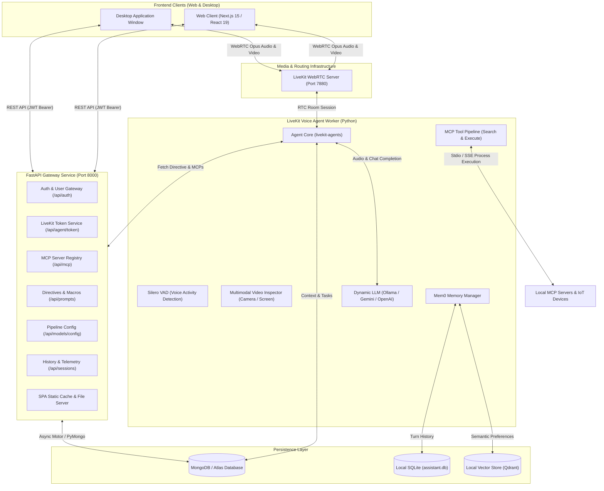

# Exia — Personal AI Assistant Architecture & Project Overview

Welcome to the central documentation for **Exia**, a next-generation, private multimodal personal assistant. Exia delivers real-time, low-latency voice and vision intelligence powered by **LiveKit WebRTC**, **Model Context Protocol (MCP)**, **Mem0 Universal Memory**, and flexible **LLM pipelines** (Local Ollama, Google Gemini Live, OpenAI, Claude, and modular speech engines).

---

## 1. Executive Summary

Exia is engineered to serve as a private, autonomous, and extensible personal companion for daily productivity, home control, and task automation. Unlike generic cloud-tethered chatbots, Exia focuses on:

- **Real-Time Voice & Vision (WebRTC)**: Bidirectional, sub-second latency audio streaming using Opus 48kHz via LiveKit, paired with live camera and screen share visual inspection.
- **Dual Deployment Formats**:
  1. **Web-Based Format**: Fully responsive, high-performance web application accessible from any modern browser (desktop, tablet, and mobile).
  2. **Desktop-Based Format**: Dedicated local desktop environment providing tight integration with local OS features, system audio hardware, local filesystems, local databases, and zero-cloud private LLMs.
- **Dynamic Tool Execution (MCP)**: Extensible tool calling via Model Context Protocol supporting both local `stdio` CLI processes and remote `sse` endpoints without token metadata bloat.
- **Adaptive Long-Term Memory**: Mem0 memory engine backed by local SQLite and vector storage to recall user preferences, facts, and past conversations across sessions.
- **Central Mission Control**: Integrated web and desktop UI for managing active persona directives, voice pipeline parameters, MCP server registries, and detailed session history telemetry.

---

## 2. Supported Formats & Delivery Models

Exia is designed from the ground up to operate seamlessly across two distinct runtime environments:

```
┌────────────────────────────────────────────────────────────────────────┐
│                          EXIA CLIENT RUNTIMES                          │
├───────────────────────────────────┬────────────────────────────────────┤
│         1. WEB-BASED FORMAT       │       2. DESKTOP-BASED FORMAT      │
│   (Next.js 15 SPA / PWA Mode)     │ (Dedicated Window / Local Client)  │
├───────────────────────────────────┼────────────────────────────────────┤
│ • Universal browser access        │ • Native desktop application feel  │
│ • Zero client-side installation   │ • Direct local system access       │
│ • Desktop, Tablet & Mobile layout │ • Offline-ready with local LLMs    │
│ • Floating bottom mobile dock     │ • Local filesystem MCP tools       │
│ • Web MediaStream audio/video     │ • Low-latency OS microphone capture│
│ • Edge-cached static delivery     │ • Local SQLite (`assistant.db`)    │
└───────────────────────────────────┴────────────────────────────────────┘
```

### A. Web-Based Format
- **Stack**: Next.js 15 (Turbopack, React 19, TypeScript, Tailwind CSS v4, Radix UI primitives, `@agents-ui`).
- **Access**: Accessed over HTTP/HTTPS at `http://localhost:3000` (development) or served directly via the FastAPI high-performance LRU cache at `http://localhost:8000`.
- **Responsive Layout**:
  - **Desktop Viewport**: Collapsible tactical sidebar with edge-hover drawer trigger and keyboard shortcut (`Ctrl+B` / `Cmd+B`).
  - **Mobile Viewport**: Compact top navigation header with an ergonomic bottom floating dock (`mobile-nav.tsx`) for one-handed operation.
- **Media Ingestion**: Utilizes standard browser WebRTC APIs (`navigator.mediaDevices.getUserMedia` and `getDisplayMedia`) to capture microphone, webcam, and system screen share tracks.

### B. Desktop-Based Format
- **Purpose**: Provides an isolated, native-feeling desktop workstation experience with enhanced local privacy and direct hardware control.
- **Capabilities**:
  - **Local Hardware Integration**: Direct binding to desktop audio input/output devices without browser permission prompts on every session.
  - **Local-First Privacy**: Can run entirely offline when connected to local LLMs (e.g., Ollama running `llama3.2`, `deepseek-r1`, or `qwen2.5`) and a local LiveKit server (`ws://localhost:7880`).
  - **Native Tool Execution**: Direct access to local CLI utilities and Model Context Protocol servers (e.g., local filesystem browsing `@modelcontextprotocol/server-filesystem`, Windows desktop automation, SQLite database query engines).
  - **In-Memory & Local Storage**: Utilizes local SQLite databases (`assistant.db` / `memory.db`) with Full-Text Search (FTS5) for instant, private data retrieval.

---

## 3. High-Level System Architecture

The following diagram illustrates how the frontend clients, LiveKit server, FastAPI backend gateway, and Python voice agent worker collaborate:



---

## 4. Key Subsystems & Features

### 4.1 LiveKit Voice & Multimodal Vision Stage
- **Real-Time WebRTC Media**: Low-latency, full-duplex communication using `@livekit/components-react` and `livekit-client`.
- **Tactical Audio Visualizers**: Four distinct visualizer styles configurable in real time:
  - **Aura**: Organic pulsating circular energy field.
  - **Wave**: Dynamic oscillating waveform frequency bars.
  - **Bar**: Classic equalizer frequency spectrum bands.
  - **Radial**: Futuristic circular HUD telemetry indicator.
- **Multimodal Video Input**: Subscribes to user camera video and screen share streams. The agent worker includes an `inspect_visual_feed` tool, allowing Exia to answer visual questions like *"What do you see?"*, *"Analyze this diagram on my screen"*, or *"Check this hardware component"*.
- **Live Transcript & Controls**: Real-time speech-to-text transcript scroller with role markers, audio toggle, camera toggle, screen share toggle, and graceful session disconnect handling.

### 4.2 Dynamic Model Context Protocol (MCP) Integration
- **2-Tier Architecture (No Token Bloat)**:
  Instead of embedding dozens of large JSON schemas inside the LiveKit JWT access token, tool schemas are stored directly in MongoDB Atlas and cached in the agent:
  1. `search_mcp_tools`: The agent searches tools by user intent or query keyword.
  2. `execute_mcp_tool`: The agent dynamically calls the target tool with validated JSON arguments.
- **Dual Transport Support**:
  - `stdio`: Executes command-line tools (e.g., `npx -y @modelcontextprotocol/server-filesystem`, Python scripts, CLI automations).
  - `sse`: Connects over HTTP Server-Sent Events to remote bridges (e.g., Home Assistant REST/SSE bridges, smart home endpoints).
- **In-App Registry & Ping**: Users can test, inspect, add, and disable MCP servers directly through the frontend MCP View.

### 4.3 Adaptive Long-Term Memory (Mem0)
- **Semantic User Profiles**: Automatically extracts personal facts, habits, and preferences from voice conversations.
- **Local Storage**: Combines local SQLite for conversational history with Qdrant vector indexing for semantic similarity search.
- **Automatic Context Injection**: Prior to speaking, the agent queries relevant memories for the current user and injects them into the system prompt context.

### 4.4 Directive & Prompt Matrix
- **Custom Personas**: Switch between different assistant personalities (e.g., *Tactical Guardian*, *Minimalist Companion*, *System Diagnostic Macro*).
- **Variable Injection**: Dynamic placeholders (`{user_name}`, `{current_time}`, `{home_temp}`, `{security_status}`, `{active_room}`) are resolved at runtime when launching sessions.
- **Active Directive Sync**: Selecting an active directive updates the database so all subsequent voice sessions inherit the persona immediately.

### 4.5 Dual-Theme Tactical Interface
- **Mecha-Inspired Visual Identity**: Signature **GN Emerald** (`#10b981`) accent highlights, high-contrast monochrome surfaces, and telemetry badges.
- **Themes**:
  - **Tactical Dark**: Deep slate `#07090e` canvas, `#0c1017` card containers, and glowing emerald telemetry.
  - **Solar Light**: Clean `#f8fafc` surfaces, crisp typography, and muted slate container accents.
- **Typography**: Powered by **Public Sans** (clean structural text) and **Commit Mono** (terminal data, telemetry, and code blocks).

---

## 5. Repository Directory Structure

```
Exia/
├── agent/                         # LiveKit Voice & Vision Agent Worker
│   ├── agent.py                   # Main entrypoint: LiveKit worker, VAD, LLM, Vision, Mem0
│   ├── db.py                      # MongoDB Atlas client & schemas (Motor/PyMongo)
│   ├── mcp_manager.py             # 2-step tool engine: search_mcp_tools & execute_mcp_tool
│   ├── token_server.py            # Standalone token utility server
│   ├── requirements.txt           # Python dependencies (livekit-agents, mem0ai, motor, etc.)
│   └── schema.sql                 # Local SQLite schema for tasks & memories
│
├── backend/                       # Central FastAPI Application & REST Gateway
│   ├── main.py                    # App entrypoint, middleware, LRU static file cache & SPA routes
│   ├── pyproject.toml             # uv / pip dependency configuration
│   └── src/
│       ├── constants/             # Pydantic schemas, DB models, and application settings
│       ├── routes/                # FastAPI endpoint routers
│       │   ├── auth.py            # /api/signup, /api/signin, /api/refresh_token, /api/me
│       │   ├── token.py           # /api/agent/token (LiveKit room token minting)
│       │   ├── mcp.py             # /api/mcp (Server registry CRUD & ping testing)
│       │   ├── prompts.py         # /api/prompts (Directive matrix & macro CRUD)
│       │   ├── model_config.py    # /api/models/config (Speech pipeline configuration)
│       │   └── sessions.py        # /api/sessions (History listing, transcript detail, close-out)
│       ├── services/              # Business logic (auth, db, security, token blacklist)
│       └── utils/                 # Utility helpers (JWT validation, password hashing)
│
├── ui/                             # UI applications (monorepo)
│   ├── web/                        # Web UI — Next.js 15 + React 19
│   │   ├── app/                    # Next.js App Router (layout.tsx, page.tsx)
│   ├── components/
│   │   ├── agents-ui/             # LiveKit visualizers, control bar, transcript bubbles
│   │   ├── app/                   # App root wrapper, theme provider, view controller
│   │   ├── layout/                # AppShell, collapsible sidebar, mobile dock
│   │   ├── screens/               # Views: session, history, mcp, prompts, models, settings, login
│   │   └── ui/                    # Reusable atomic UI components (Radix + Tailwind)
│   ├── context/                   # React context providers (AuthContext)
│   ├── hooks/                     # Custom React hooks (useAgentErrors, useDebug)
│   ├── lib/                       # Strongly typed API client (`api.ts`) and TypeScript types
│   ├── public/                    # Branded assets, images, multi-resolution favicons
│   ├── styles/                    # Global Tailwind CSS v4 styling
│   └── package.json               # Frontend dependencies & npm scripts
│
├── docs/                          # Project Documentation
│   ├── project-overview.md        # This comprehensive project document
│   ├── home-assistant-requirements.md # Technical specification & REST contract
│   └── prompts.txt                # Frontend UI design guidelines & research prompts
│
├── mongodb_schema.json            # JSON schema validation rules for MongoDB collections
└── README.md                      # High-level starter guide
```

---

## 6. API Reference Summary

All backend REST API endpoints are prefixed with `/api`. Interactive documentation is available via Swagger UI at `/api/docs` and ReDoc at `/api/redoc`.

| Group | Method | Endpoint | Description |
| --- | --- | --- | --- |
| **Auth** | `POST` | `/api/signup` | Register a new operator account |
| **Auth** | `POST` | `/api/signin` | Authenticate and obtain JWT access & refresh tokens |
| **Auth** | `POST` | `/api/refresh_token` | Renew an expired access token |
| **Auth** | `GET` | `/api/me` | Fetch authenticated user profile |
| **Auth** | `POST` | `/api/update_password`| Change operator password |
| **LiveKit** | `POST` | `/api/agent/token` | Mint a LiveKit room token with participant grants |
| **Sessions** | `GET` | `/api/sessions` | List paginated voice sessions with telemetry |
| **Sessions** | `GET` | `/api/sessions/{id}` | Retrieve full transcript and tool execution logs |
| **Sessions** | `POST` | `/api/sessions/{id}/end` | Close an active session and persist duration |
| **Sessions** | `DELETE`| `/api/sessions/{id}` | Delete a session and associated audit logs |
| **MCP** | `GET` | `/api/mcp` | List registered MCP tool servers |
| **MCP** | `POST` | `/api/mcp` | Register a new `stdio` or `sse` MCP server |
| **MCP** | `PUT` | `/api/mcp/{id}` | Update MCP configuration or toggle enabled state |
| **MCP** | `DELETE`| `/api/mcp/{id}` | Remove an MCP server |
| **MCP** | `POST` | `/api/mcp/{id}/test` | Ping and discover tools on an MCP server |
| **Prompts** | `GET` | `/api/prompts` | List saved directives and prompt macros |
| **Prompts** | `POST` | `/api/prompts` | Create a new directive or macro |
| **Prompts** | `PUT` | `/api/prompts/{id}` | Update directive text or metadata |
| **Prompts** | `POST` | `/api/prompts/{id}/set-active` | Designate directive as the active system prompt |
| **Prompts** | `DELETE`| `/api/prompts/{id}` | Delete a prompt directive |
| **Models** | `GET` | `/api/models/config` | Get active speech pipeline parameters |
| **Models** | `PUT` | `/api/models/config` | Update model, voice timbre, or hyperparameters |
| **Health** | `GET` | `/api/health` | Service uptime and diagnostic check |

---

## 7. Quick Start & Execution Guide

### Prerequisites
- **Node.js**: v20.0.0 or higher (pnpm recommended)
- **Python**: v3.11 or v3.12
- **LiveKit Server**: Local instance via `livekit-server --dev` or a free LiveKit Cloud project
- **MongoDB**: Local MongoDB instance (`mongodb://localhost:27017`) or MongoDB Atlas cluster
- **LLM Provider**: Local Ollama (`http://localhost:11434`) or Gemini / OpenAI API key

---

### Step 1: Start LiveKit Server
```bash
# If using the LiveKit CLI locally:
livekit-server --dev
```
*Default local credentials: URL `ws://localhost:7880`, Key `devkey`, Secret `secret`.*

---

### Step 2: Configure & Start the Backend Gateway
```bash
cd backend
python -m venv .venv
source .venv/bin/activate  # On Windows: .venv\Scripts\activate
pip install -e .           # Or install via uv sync

# Start the FastAPI server with hot-reload
uvicorn main:app --host 0.0.0.0 --port 8000 --reload
```
*API docs will be accessible at: `http://localhost:8000/api/docs`.*

---

### Step 3: Configure & Run the Voice Agent Worker
```bash
cd agent
python -m venv .venv
source .venv/bin/activate  # On Windows: .venv\Scripts\activate
pip install -r requirements.txt

# Configure your .env file with LIVEKIT_URL, LIVEKIT_API_KEY, LIVEKIT_API_SECRET, etc.
python agent.py dev
```
*The worker will connect to LiveKit and await incoming room sessions.*

---

### Step 4: Run the Frontend (Web & Desktop Formats)

#### Running in Web Format:
```bash
cd ui/web
pnpm install
pnpm dev
```
*Open your browser at `http://localhost:3000`.*

#### Running in Desktop Format:
You can package or launch the frontend as a dedicated desktop window:
1. Build the production static bundle:
   ```bash
   cd ui/web
   pnpm build
   ```
2. Run via an Electron/Tauri desktop shell wrapper pointing to the local build, or launch a dedicated Chromium app-mode window:
   ```bash
   # Windows Chromium App Mode shortcut
   chrome.exe --app=http://localhost:3000 --window-size=1280,820
   ```
3. Alternatively, access it via the FastAPI SPA server with cached static assets at `http://localhost:8000`.

---

## 8. Development Roadmap

1. **Native Desktop Shell**: Formal packaging with Electron or Tauri with system tray docking, global push-to-talk hotkey, and automatic local process management.
2. **Offline Speech Pipeline**: Fully local Speech-to-Text (Whisper.cpp) and Text-to-Speech (Piper / Kokoro) for 100% air-gapped voice operation.
3. **Smart Home Discovery**: Zero-configuration mDNS discovery of local Home Assistant instances and Zigbee/Matter gateways.
4. **Autonomous Cron Routines**: Background scheduled tasks triggered at specific times to deliver morning briefs, calendar reviews, and security patrols.

---

*Authored for the Exia Project — High-Performance Multimodal Personal AI Assistant.*
