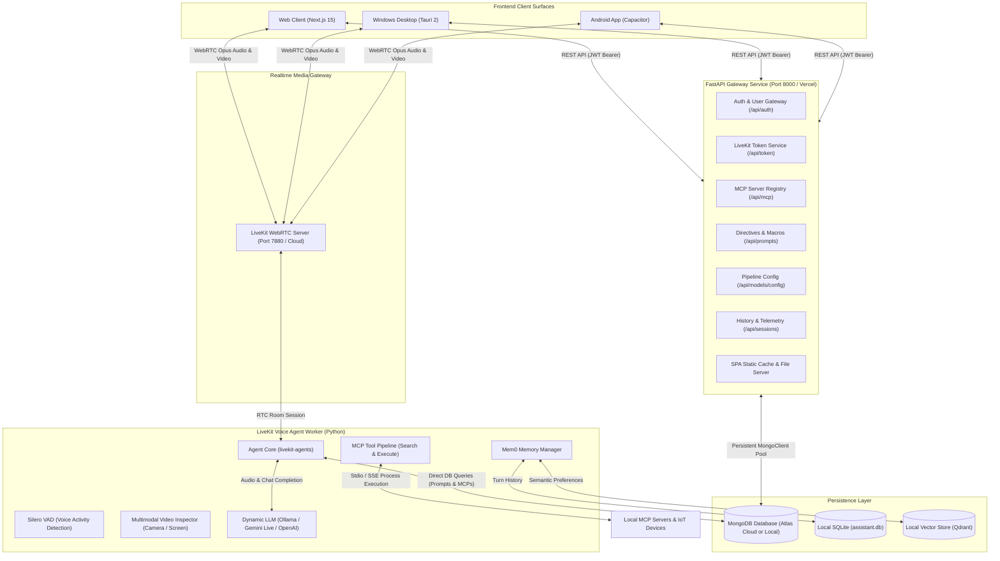

# Exia — Personal AI Assistant Architecture & Project Overview

Welcome to the central documentation for **Exia**, a next-generation, private multimodal personal assistant. Exia delivers real-time, low-latency voice and vision intelligence powered by **LiveKit WebRTC**, **Model Context Protocol (MCP)**, **Mem0 Universal Memory**, and flexible **LLM pipelines** (Local Ollama, Google Gemini Live, OpenAI, Claude, and modular speech engines).

---

## 1. Executive Summary

Exia is engineered to serve as a private, autonomous, and extensible personal companion for daily productivity, home control, and task automation:

- **Real-Time Voice & Vision (WebRTC)**: Bidirectional, sub-second latency audio streaming using Opus 48kHz via LiveKit, paired with live camera and screen share visual inspection.
- **Unified Multi-Platform Client Ecosystem** (Expo / React Native — see [`ui/README.md`](file:///e:/potfolio/Exia/ui/README.md)):
  1. **Android App** ([`ui/apps/mobile`](file:///e:/potfolio/Exia/ui/apps/mobile)): Expo (React Native 0.88) universal app with Expo Router and shared `@exia/*` packages.
  2. **Web Client** ([`ui/apps/web`](file:///e:/potfolio/Exia/ui/apps/web)): Legacy Next.js 15 & React 19 interface — remains the production web UI during the Expo migration.
  3. **Windows Desktop Client** ([`ui/apps/windows`](file:///e:/potfolio/Exia/ui/apps/windows)): Native React Native Windows app (planned — RNW 0.85 pairing; see its README).
- **Dynamic Tool Execution (MCP)**: Extensible tool calling via Model Context Protocol supporting both local `stdio` CLI processes and remote `sse` endpoints without token metadata bloat.
- **Adaptive Long-Term Memory**: Mem0 memory engine backed by local SQLite and vector storage to recall user preferences, facts, and past conversations across sessions.
- **Central Mission Control**: Integrated UI for managing active persona directives, voice pipeline parameters, MCP server registries, and detailed session history telemetry.

---

## 2. Supported Formats & Delivery Models

Exia's clients are being migrated to the Expo / React Native stack defined in [`ui/README.md`](file:///e:/potfolio/Exia/ui/README.md). Current state:

```
┌───────────────────────────────────────────────────────────────────────────────┐
│                             EXIA CLIENT RUNTIMES                              │
├───────────────────────┬───────────────────────────────┬───────────────────────┤
│  1. ANDROID (ACTIVE)  │   2. WEB (LEGACY → EXPO)      │  3. WINDOWS (PLANNED) │
│  Expo · RN 0.88       │   Next.js 15 → Expo RN Web    │  RN Windows · RN 0.85 │
├───────────────────────┼───────────────────────────────┼───────────────────────┤
│ • Expo Router routes  │ • Production web UI today     │ • Native WinUI layer  │
│ • Shared @exia/* pkgs │ • Static export / Vercel      │ • Own install (RN ver │
│ • Expo Go / dev build │ • Replaced at Milestone 4     │   differs from Expo)  │
│ • EAS or local build  │ • LiveKit components-react    │ • VS 2022 toolchain   │
└───────────────────────┴───────────────────────────────┴───────────────────────┘
```

### A. Android App (`ui/apps/mobile`) — Milestone 3
- **Stack**: Expo SDK 58, React Native 0.88, Expo Router (typed routes), TypeScript.
- **Status**: Scaffolded inside the `ui/` pnpm workspace; consumes `@exia/shared-types`, `@exia/api-client`, `@exia/design-tokens`, `@exia/shared-ui`, `@exia/shared-logic`.
- **Next**: port the legacy web screens (voice stage, history, MCP, prompts, models, settings) onto the shared primitives; builds via Expo Go (dev) or EAS/local Gradle (native).

### B. Web Client (`ui/apps/web`) — legacy during migration
- **Stack**: Next.js 15 (Turbopack, React 19, TypeScript, Tailwind CSS v4, Radix UI primitives, `@agents-ui`).
- **Access**: `http://localhost:3000` (development) or served via the FastAPI static cache at `http://localhost:8000`.
- **Sunset plan**: replaced by the Expo web export (`npx expo export --platform web`) once screen parity is reached (Milestone 4).

### C. Windows Desktop Client (`ui/apps/windows`) — Milestone 5 (not initialized)
- **Stack**: React Native Windows 0.85 (pairs with RN 0.85 — verified pairing required before init).
- **Workspace note**: intentionally outside the pnpm workspace — Expo's monorepo guide forbids duplicate React Native versions in one workspace.
- **Prerequisites & checklist**: see [`ui/apps/windows/README.md`](file:///e:/potfolio/Exia/ui/apps/windows/README.md).

---

## 3. High-Level System Architecture



---

## 4. Key Subsystems & Features

### 4.1 LiveKit Voice & Multimodal Vision Stage
- **Real-Time WebRTC Media**: Low-latency, full-duplex communication using `@livekit/components-react` and `livekit-client`.
- **Tactical Audio Visualizers**: Five distinct visualizer styles configurable in real time: `Wave`, `Bar`, `Grid`, `Radial`, and `Aura`.
- **Multimodal Video Input**: Subscribes to user camera video and screen share streams with on-demand vision analysis via agent tools.
- **Live Transcript & Controls**: Real-time transcript with role markers, audio toggle, camera toggle, screen share toggle, and session close-out.

### 4.2 Dynamic Model Context Protocol (MCP) Integration
- **2-Tier Architecture (No Token Bloat)**:
  Tool schemas are stored in MongoDB Atlas and dynamically queried by the agent:
  1. `search_mcp_tools`: The agent searches tools by user query or intent.
  2. `execute_mcp_tool`: The agent dynamically calls the target tool with validated JSON arguments.
- **Dual Transport Support**: Both `stdio` (local subprocesses) and `sse` (HTTP Server-Sent Events).

### 4.3 Adaptive Long-Term Memory (Mem0)
- **Semantic User Profiles**: Automatically extracts personal facts and preferences from voice conversations.
- **Context Injection**: Injects relevant past context dynamically before each LLM turn.

---

## 5. Repository Directory Structure

```
Exia/
├── agent/                         # LiveKit Voice & Vision Agent Worker
│   ├── agent.py                   # LiveKit worker: VAD, Gemini Live/LLM, Vision, Mem0
│   ├── db.py                      # MongoDB Atlas client & schemas
│   ├── mcp_manager.py             # 2-step tool engine: search_mcp_tools & execute_mcp_tool
│   ├── token_server.py            # Standalone token utility server
│   ├── requirements.txt           # Python dependencies (livekit-agents, mem0ai, motor)
│   └── schema.sql                 # Local SQLite schema for tasks & memories
│
├── backend/                       # Central FastAPI Application & REST Gateway
│   ├── main.py                    # Standalone FastAPI Server Gateway (local dev & production)
│   ├── pyproject.toml / uv.lock   # Python dependencies managed with uv
│   ├── dist/                      # Production build static SPA fallback
│   └── src/
│       ├── constants/             # Settings, Pydantic schemas, database collections
│       ├── routes/                # FastAPI endpoint routers (auth, token, sessions, mcp, prompts, models)
│       ├── services/              # Business logic (pooling db, auth, security, bootstrap seed)
│       └── utils/                 # Utility helpers (JWT validation, password hashing)
│
├── ui/                            # Client Applications (Monorepo)
│   ├── apps/
│   │   ├── mobile/                 # Expo (React Native) — Android app, universal codebase
│   │   ├── web/                    # [LEGACY] Next.js 15 web client during Expo migration
│   │   └── windows/                # React Native Windows (planned)
│   └── packages/                   # @exia/* shared packages (shared-types, api-client, design-tokens, …)
│
├── scripts/                        # Centralized Build & Deployment Pipelines
│   ├── desktop.sh                  # [LEGACY] Tauri 2 pipeline — obsolete after the RN Windows decision
│   ├── android.sh                  # [LEGACY] Capacitor pipeline — obsolete after the Expo decision
│   └── compile.sh                  # Unified compilation dispatcher
│
├── docs/                          # In-Depth Documentation & Diagrams
│   ├── project-overview.md        # Central project architecture and overview
│   ├── desktop-architecture.md    # Windows Desktop (Tauri 2) technical guide
│   ├── web-architecture.md        # Vercel serverless web architecture guide
│   ├── database-schema.md         # MongoDB collection specifications
│   └── architecture/              # Editable draw.io diagrams
│
├── README.md                      # High-level repository guide
└── .env.example                   # Environment configuration template
```

---

## 6. Development & Build Quick Start

### Step 1: Start Backend Gateway
```bash
cd backend
uv run uvicorn main:app --reload --host 0.0.0.0 --port 8000
```

### Step 2: Run Voice Agent Worker
```bash
cd agent
python agent.py dev
```

### Step 3: Launch Clients
```bash
# A. Web Client (legacy Next.js — still the production web UI during migration)
cd ui/apps/web && pnpm dev

# B. Expo Android app (development — emulator, device, or Expo Go)
cd ui/apps/mobile && pnpm start
```
